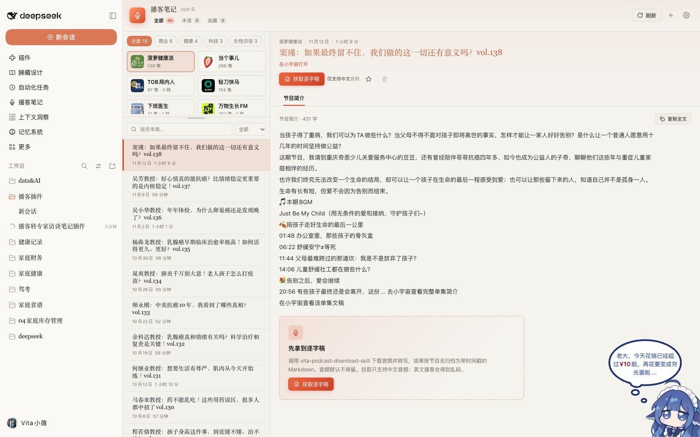

# 播客笔记（dsh-podcast-notes）



把「RSS 追更 → 逐字稿 → 专家访谈笔记」收进 DSH 侧栏。左侧栏点开就能用，右侧栏也能常驻。

> **只支持中文播客音频。** 英文、日文等非中文节目转写会得到音译乱码；插件会在看起来是英文的节目上提醒，请不要对非中文节目点「获取逐字稿」。

## 安装

这是一个 [DeepSeek Harness](https://github.com/deepseek-ai/DeepSeek-Harness) 插件：

```bash
git clone https://github.com/weiyudubai/dsh-podcast-notes.git
dsh plugin --profile desktop add ./dsh-podcast-notes
```

装完重启（或刷新）DSH，左侧栏会多出一个 **播客笔记** 图标。

> `dsh` 在 DeepSeek Harness 安装包的 `Contents/Resources/runtime/cli/bin/dsh`；没在 PATH 里就用全路径或先加进去。
>
> 卸载：`dsh plugin --profile desktop remove dsh-podcast-notes`。

## 第一次使用：准备转写环境

打开「播客笔记」→ 右上角齿轮 →「转写环境」→ 点 **一键准备转写环境**。

插件会自动下载依赖并装好，不需要终端、不需要额外申请 key，也不需要另装 skill。转写脚本和笔记提示词已经随仓库自带。

- 首次约 **5 分钟**，需要联网，占用约 2GB。
- 之后转写 80 分钟中文播客，约 **2 分钟**；首次转写会多花一点时间下载识别模型。
- 装好后获取逐字稿、生成笔记都在插件里完成。

## 怎么用

1. **加播客**：点右上角 **+**，粘贴 RSS 地址 →「读取分类」→ 选分类 → 添加。
2. **看更新**：标题下方有 **全部 / 未读 / 收藏** 三个分栏。未读和收藏会跨所有播客汇总，列表里标出节目名。
3. **清历史**：切到「未读」，列表标题右边有 **全部已读**；点一下会确认，然后清掉所有播客的未读角标。
4. **转写**：点开一集 → **获取逐字稿**。完成后在「逐字稿」页签看带时间戳的文字。
5. **做笔记**：点 **生成专家访谈笔记**。生成后可以直接编辑 Markdown、选中文字高亮，或点「只看高亮」回顾。
6. **管理**：右键播客卡片可以改分类、清这个播客的未读；右键单集可以标星或改回未读。
7. **回到上次**：重新进入插件会恢复上次打开的播客、单集、页签和阅读位置。
8. **调布局**：拖动中间的分隔线调整左侧宽度；点顶部面板图标收起左侧列表，专注看右边内容；再点左侧小标签或面板图标展开。

## RSS 是什么，去哪找

RSS 是播客的「更新订阅地址」，给软件读的，不是给人看的主页。它通常长这样：

- `https://feed.xyzfm.space/xxxx`
- `https://example.com/podcast.xml`

在浏览器里打开可能是一堆代码，这是正常的，复制地址就行。

找地址：

- **[getpodcast.xyz](https://getpodcast.xyz/)**：常见中文播客的现成 RSS；也有 iPhone 快捷指令，可把小宇宙、Apple Podcasts 等链接转成 RSS。
- **小宇宙 App**：节目页右上角分享 → 更多 →「获取播客 RSS 订阅」，按提示留邮箱。
- 大部分播客官网或节目页也会给出 RSS 图标。

插件支持任何标准 RSS。Podwise 这类需要代理的地址，插件会自动读取 macOS 系统代理。

## 文件与设置

默认数据目录：`~/.dsh/podcast-notes/data/`。逐字稿和笔记都是「播出日期_标题.md」，带 `[mm:ss]` 时间戳。

想换数据目录、换模型，点右上角齿轮。笔记由 DSH 当前配置的模型生成，默认会自动降低思考档位，避免思考占满输出；如果笔记被截断，可以在设置里调高「笔记最大 token」。

## 注意

- 右侧栏需要 DSH 自带右侧栏服务（当前桌面版 0.3.x 已包含）；DSH 太旧时插件不会加载。
- 有些播客的 RSS 音频是试听、静音或付费片段，转写会提示「没有识别到有效语音」，不会留下空文件。
- 生成的是「专家访谈笔记」，不是行动清单：保留观点、数字、案例和不确定处，不硬编下一步任务。

## 开发

```bash
node --check index.js && node --check client.js
dsh plugin --profile desktop add .
```

## 许可

[MIT](LICENSE)
