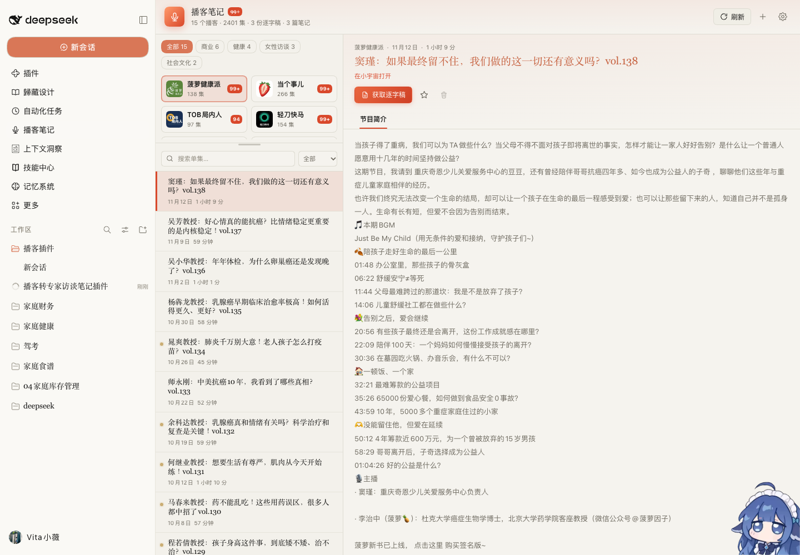

# 播客笔记（dsh-podcast-notes）



把「RSS 追更 → 逐字稿 → 专家访谈笔记」收进 DSH 左侧栏的一个插件。

左边栏点开就能用：订阅几个播客，追更自动刷新，一键拿到逐字稿，再变成可编辑、可高亮的专家访谈笔记。

## 安装

这是一个 [DeepSeek Harness](https://github.com/deepseek-ai/DeepSeek-Harness) 插件，在 DSH 里用下面的命令装（把路径换成你自己的）：

```bash
# 1. 克隆仓库
git clone https://github.com/nix133008-ctrl/dsh-podcast-notes.git

# 2. 装进你的 DSH profile（profile 名字按你自己的来，桌面版一般是 desktop）
dsh plugin --profile desktop add ./dsh-podcast-notes
```

装完重启（或刷新）DSH，左侧栏就会多出一个 **播客笔记** 图标。

卸载的话：

```bash
dsh plugin --profile desktop remove dsh-podcast-notes
```

> `dsh` 命令在 DeepSeek Harness 安装包的 `Contents/Resources/runtime/cli/bin/dsh`，如果没在 PATH 里，把它加进去或者用全路径。
>
> 用图形界面的话，在「插件 / Plugins」里从本地目录安装也行。

### 转写需要额外的 Python 环境

逐字稿转写用的是 [FunASR](https://github.com/modelscope/FunASR)（本地离线识别，**不消耗任何大模型额度**），需要准备一份 Python 环境。

**方式一（推荐）**：把 `vita-podcast-download-skill` 克隆到本仓库旁边，插件会自动找到它：

```bash
git clone https://github.com/nix133008-ctrl/dsh-podcast-notes.git
git clone <vita-podcast-download-skill 的仓库地址> vita-podcast-download-skill
cd vita-podcast-download-skill
python3 -m venv .venv
.venv/bin/pip install funasr modelscope torch feedparser requests tqdm
```

**方式二**：装成 DSH skill，然后按下面的表改路径。

第一次转写会下载离线识别模型（几百 MB），之后就走本地缓存，不再联网。

装好之后打开插件右上角的齿轮，把这三个路径指过去（一般不用改，插件会自动找）：

| 设置项 | 默认查找位置 |
| --- | --- |
| Python 解释器 | `./vita-podcast-download-skill/.venv/bin/python` → `~/.claude/skills/vita-podcast-download-skill/.venv/bin/python` → `~/.dsh/skills/...` |
| 转写脚本 | `./vita-podcast-download-skill/scripts/podcast_to_md.py` → `~/.claude/skills/vita-podcast-download-skill/scripts/podcast_to_md.py` → `~/.dsh/skills/...` |
| 笔记 skill | `~/.dsh/skills/expert-interview-notes/SKILL.md` → `~/.claude/skills/expert-interview-notes/SKILL.md` |

笔记 skill 决定笔记长什么样（结构、写作风格、禁用项）。如果它不在上面任何一个位置，把它的 `SKILL.md` 路径填进设置里就行。

笔记生成用的是 **DeepSeek Harness 当前配置的模型**（默认跟随 DSH 设置），不用额外申请 key。

## 怎么用

1. 点左侧栏的 **播客笔记**。
2. 第一次打开会自动抓取订阅；以后打开也会检查更新，面板开着时按设置里的间隔自动刷新。想立刻更新就点右上角 **刷新**。
3. 左边选播客、再选一集。上方可以按分类筛选，也可以搜索标题；下拉框还能只看「未读」「星标」。播客卡片按两列排，上下拖动卡片区底部的横条可以调高，方便一次看更多播客；双击横条恢复默认高度。
4. 没点开过的单集左边有暖黄色小圆点，标题加粗；点开后自动标为已读。右键单集可以「标星」或改回未读。
5. 点 **获取逐字稿**，等任务跑完。
6. 切到 **逐字稿** 可以看带时间戳的文字；点 **生成专家访谈笔记**，生成完会自动保存。
7. 笔记生成后，可以复制全文、在 Finder 里打开文件，或者删除重来。
8. 详情页的大标题是链接，点击会在浏览器里打开这一期在小宇宙的页面；左侧单集列表里的标题保持纯文本，点标题之外的地方切换单集。
9. **节目简介** 页签显示 RSS 里的完整简介（不再截断），顶部有字数和「复制全文」。
10. **编辑笔记**：在「专家访谈笔记」页签点 **编辑**，可以直接改 Markdown 原文，改完点 **保存** 写回同一个 .md 文件。
11. **高亮金句**：在阅读视图里选中一段文字，会浮出一个「高亮这段」按钮；点一下就在原文里加上 `==` 标记，存成黄色高亮。也可以在编辑框里选中文字点 **高亮选中**。点 **只看高亮** 可以把所有标过的句子列成一页回顾。
    - 高亮用 `==文字==` 这个标准 Markdown 语法写在文件里，换台电脑、用别的 Markdown 软件看都还在。

## 订阅管理

- 默认预置了 4 个播客（小宇宙的 `feed.xyzfm.space` 地址），点右上角 **+** 可以加新的 RSS 地址。
- 任何标准 RSS 都能加：小宇宙、Pocket Casts、Overcast、Podwise 生成的地址等等。
- 加播客时先点「读取分类」，插件会读出节目信息和 RSS 分类；你可以选一个分类，也可以直接输入自定义分类。一个播客只属于一个分类。
- 想改分类：右键左侧的播客卡片 → **修改分类…**，在已有分类的下拉框里选一个；要新分类就选「＋ 新建分类…」。改完立即生效。
- 每个播客卡片右侧的数字是未读集数；右键播客卡片可以 **全部标为已读**。
- 标星的单集右上角会出现金色星标；再右键一次即可取消。
- 如果 RSS 只能通过系统代理访问（例如 Podwise 生成的 RSS），插件会自动读取 macOS 的系统代理；代理关闭时走直连。
- 旧版本没有逐集已读记录，升级后现有单集会先显示为未读；右键播客卡片点一次「全部标为已读」即可清掉历史角标。

## 文件存在哪

默认数据目录是 `~/cc/vibe/播客/podcast-data/`：

```
podcast-data/
├── library.json                 订阅列表
├── episodes/                    每档播客的节目索引
├── transcripts/<播客id>/        逐字稿 Markdown
└── notes/<播客id>/              专家访谈笔记 Markdown
```

想换个位置，点右上角齿轮改「数据目录」即可。

逐字稿文件名是「播出日期_标题.md」，笔记同理，都带 `[mm:ss]` 时间戳，方便回听定位。

想换目录、换 Python 解释器、换模型，点右上角齿轮。

## 几个注意点

- 第一次转写要下载离线识别模型，会慢一些；之后同一台机器会快很多。
- 转写靠 `vita-podcast-download-skill` 的 Python 环境。默认路径已经填好；如果换电脑，去设置里改成新路径。
- 报「找不到 Python」或「找不到脚本」时，把上面表格里的两个路径改成你自己的；保存后插件会提示路径是否存在。
- 有些播客的 RSS 音频是试听、静音或付费片段，转写会提示「没有识别到有效语音」，不会留下空文件。
- 笔记由当前 DSH 模型生成。插件会自动把「深度思考」调到最低档，避免思考占满输出额度；如果仍提示没有返回内容或被截断，换一个模型，或把「笔记最大 token」调高。
- 生成的是「专家访谈笔记」，不是行动清单：它保留嘉宾的观点、数字、案例和不确定处，不会硬编下一步任务。

## 开发

```bash
# 语法检查
node --check index.js && node --check client.js

# 装进本地 profile 试跑
dsh plugin --profile desktop add .
```

目录结构：

```
dsh-podcast-notes/
├── index.js            Host 半边：注册 /podcast-notes/api 路由、跑转写和笔记任务
├── client.js           浏览器半边：左侧栏面板
├── lib/rss.js          RSS 解析 + 系统代理适配
├── lib/store.js        订阅库、单集状态、文件布局
├── lib/transcribe.js   调用 Python 脚本转写
├── lib/notes.js        调用 DSH 模型生成专家访谈笔记
├── cordis.patch.yml    插件挂载声明
└── icon.svg            左侧栏图标
```

## 许可

[MIT](LICENSE)
